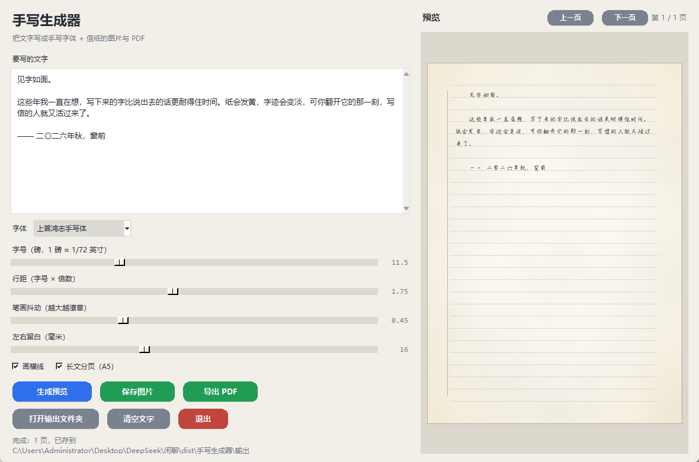

# 手写生成器 · Handwriting Worksheet Generator

把一段文字渲染成「**手写字体 + 程序化信纸**」的图片与 PDF 的桌面小工具。
图形界面，按钮带按下回弹动画，**完全离线**，不需要联网、不需要账号。



> 适合做手写笔记、作业誊写、书信、贺卡、创意配图。
> **不适用于**任何需要真实身份或法律效力的文书（借据、收据、合同、证明、签名等）——
> 本工具生成的是**合成笔迹**，不是本人手写。

---

## 特点

- **8 种排版自由度**：字号、行距、笔画抖动、左右留白、字体、横线开关、A5 分页、随机种子
- **字坐在横线上**：把行距扰动归零，再按「实际渲染出的每行底边」画横线，逐行对齐
- **长文自动分页**：在超高画布上一次渲染完，再按整行切开，**切口落在两行中间**，不会切断一行字
- **正片叠底（multiply）**：支持把字压到**真实纸张照片**上，字会跟着照片的明暗一起变化
  （见 `docs/真实纸张照片说明.md`，含单应变换做透视校正的做法）
- **纯本地**：Pillow + numpy + [handright](https://github.com/Gsllchb/Handright)，无网络请求

---

## ⚠️ 字体不随仓库分发

本仓库**不包含任何字体文件**。原因：

原先那批中文字体（上首、品如、青叶等）来自一个**没有开源许可证**的第三方安装包，
属于商业字体，**不能二次分发**。

怎么用自己的字体（任选其一）：

1. 在程序目录下新建 `字体/` 文件夹，把 `.ttf` / `.otf` 丢进去，重启程序即可出现在下拉框里；
2. 或直接点界面上的 **「＋ 添加字体」** 按钮选文件，程序会自动复制到 `字体/` 文件夹。

**没有任何自定义字体时**，程序会自动回退到 Windows 自带字体（楷体 / 仿宋 / 黑体 / 宋体 / 微软雅黑），
功能完整可用，只是笔迹没那么"手写"。

> 推荐几个**许可明确**的开源中文字体（自行下载，注意各自协议）：
> 霞鹜文楷 LXGW WenKai、思源宋体/黑体、站酷系列（部分限个人使用）。
> 具体授权请以字体官方说明为准，本仓库不做担保。

---

## 快速开始

### 方式一：直接用 exe（Windows x64）

到 [Releases](../../releases) 下载 `手写生成器_绿色版.zip`，解压后双击 `手写生成器.exe`。

> 首次运行可能被 SmartScreen 拦一下（未签名的自制 exe 都会），点「更多信息 → 仍要运行」。
> 压缩包里**不含字体**，按上一节的方法自己加。

### 方式二：从源码跑

```powershell
pip install -r requirements.txt
python 手写生成器.py
```

依赖：Python 3.9+、Pillow、numpy、handright。

> `handright` 声明 `pillow<11`，但实测 8.2.0 在 Pillow 12 下正常工作。
> 若你的环境冲突，可以 `pip install --no-deps handright==8.2.0`。

### 方式三：命令行（不用界面）

```powershell
# 单页（高度按内容自动裁）
python paper_write.py --text "见字如面。" --font "字体/你的字体.ttf" --out 成品.png

# 长文分 A5 页
python paper_write.py --file 文字.txt --font "字体/你的字体.ttf" --out 成品 --pages
```

---

## 界面说明

| 控件 | 作用 |
| --- | --- |
| 要写的文字 | 空行会被当作段落分隔 |
| 字体 | 下拉选择；「＋ 添加字体」可加入自己的 ttf |
| 字号（磅） | 1 磅 ≈ 1/72 英寸。调大 → 每行字变少、页数变多 |
| 行距（字号 × 倍数） | 1.75 是默认；1.5 更紧凑 |
| 笔画抖动 | 越大越潦草；0 = 工整 |
| 左右留白（毫米） | 正文左右各留多宽 |
| 画横线 | 勾上 = 横线信纸；取消 = 素纸 |
| 长文分页（A5） | 勾上按 148×210 mm 逐页排 |

按钮：**生成预览 / 保存图片 / 导出 PDF / 打开输出文件夹 / 清空文字 / 退出**。

**输出位置**：程序会自动挑一个**真的能写**的目录（exe 旁边的 `输出` → `文档\手写稿输出` → 用户目录 → 临时目录），
状态栏会显示实际路径。

---

## 按钮的「回弹」怎么做的

按钮是**画布自绘的圆角矩形**，三层反馈：

1. **悬停**：底色亮一档
2. **按下**：整体下沉 2 px、底色加深、底部阴影变薄
3. **松手**：按 `1 → 0 → −1 → 0` 走四帧（每帧 18 ms），先弹过头再落回

改幅度看 `BounceButton._on_press` 里的 `self._offset = 2`；改快慢看 `_spring` 里的 `18 * (i + 1)`。

---

## 自己打包

```powershell
python -m PyInstaller --noconfirm --windowed --name 手写生成器 `
  --add-data "paper_write.py;." `
  --add-data "handwrite.py;." `
  --hidden-import handright --distpath dist --workpath build 手写生成器.py
```

想把字体也一起打进去（**仅限你有分发权的字体**）：

```powershell
--add-data "字体;字体"
```

### 开发自检

```powershell
python 手写生成器.py --selftest 自检.png
```

自动填样例文字 → 生成 → 截图 → 退出，并写 `自检_log.txt`。
日志出现 `OK pages=N` 表示链路正常；出现 `ERR` 会带完整 traceback。

---

## 已知限制

- **只支持横排**，不支持竖排；**只有横线，没有方格/田字格**
- 「〇」(U+3007) 在多数中文手写字体里缺失，程序会自动换成「零」
- 行是**严格等距**的（为了对线），所以没有"手写越写越歪"的自然感
- 生成中途关窗口，进程会立刻退出，正在写的那一页可能留下不完整的 PNG
- 只做了 onedir 打包（启动快）；onefile 版每次启动要解压到临时目录，会慢 5～15 秒

---

## 许可

**代码**：MIT，见 [LICENSE](LICENSE)。

**字体**：**不包含在本仓库内**，请自行准备并遵守其各自授权。

**依赖**：[handright](https://github.com/Gsllchb/Handright)（BSD-3-Clause）、Pillow、numpy。

---

## 关于 AI 生成内容标识

本工具产出的是**程序合成的笔迹**。若你要把生成图公开发布，请遵守所在平台对
「AI 生成／合成内容」的标识要求（例如中国的 GB 45438-2025）。
本项目不代替你做这一步。
